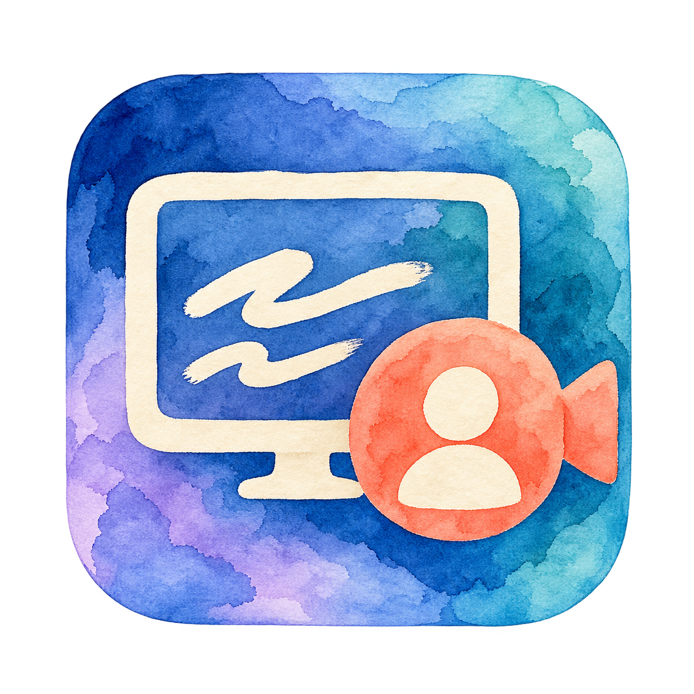

<p align="center"></p>

# Cameo Studio

A native macOS recorder that combines your screen, camera and microphone into one MP4, with a floating teleprompter that stays out of the recording.

**Apple Silicon · macOS 15+ · English / 简体中文 · Local processing**

[Download the latest release](https://github.com/JoyceGu/cameo-studio/releases/latest) · [中文使用说明](使用说明.md)

## Features

- Record a display or an individual window, including browser and desktop apps.
- Composite your camera into the recording as a circle or rounded rectangle; adjust size, position and mirroring.
- Read an editable, scrolling teleprompter with adjustable text size and speed. Pause scrolling or return to the top; scripts save locally.
- Keep the recorder controls, teleprompter and camera preview out of screen capture; the camera is added separately to the exported video.
- Choose the original camera background, adjustable background blur, or one of three image presets: Bright study, Soft nature and Soft watercolor.
- Switch between English and Simplified Chinese in Settings without restarting. Language and background choices persist.
- Export H.264 video and AAC microphone audio in an MP4. No account, API key or cloud processing required.

## Install

Download `Cameo-Studio-0.3.0-macOS-arm64.zip` from [Releases](https://github.com/JoyceGu/cameo-studio/releases), extract it and open **Cameo Studio.app**.

This is an early local prototype. The prebuilt app is ad hoc signed, **not Developer ID signed or notarized**, so macOS may prevent opening an Internet-downloaded copy. Building from source on your Mac is the alternative; the release is not an App Store distribution.

## Build from source

Install Apple's Xcode Command Line Tools, then:

```sh
git clone https://github.com/JoyceGu/cameo-studio.git
cd cameo-studio
./build.sh
open "Cameo Studio.app"
```

The script uses system Swift and frameworks only; there are no third-party dependencies. It creates an Apple Silicon binary targeting macOS 15+, signs it locally, and replaces the app only after compilation and verification. Quit any running copy before installing a new build.

## Record a video

1. Click **Choose / refresh sources**, allow screen recording when macOS asks, and select a screen or window.
2. Choose your camera and microphone. Open the camera preview and allow camera access.
3. Set camera shape, position, size and mirroring. Use **Background…** to choose blur or a preset image.
4. Open the teleprompter, paste your script and adjust scrolling. Scrolling is controlled separately from recording.
5. Click **Start recording**, choose a new output filename, and allow microphone access if needed. Recording begins after a three-second countdown.
6. Click **Stop & export** and wait for the MP4 to finish. Finder reveals the saved file.

Use **Settings → Interface language** (⌘,) to switch languages. Permission settings are managed by macOS in System Settings → Privacy & Security.

## Current limits

- Maximum output bounding box: 1920 × 1080, preserving the source aspect ratio; target screen rate: 30 fps.
- Blur and image replacement use Apple Vision person segmentation on the Mac. The processed camera rate is capped at approximately 15 fps. Hair, fingers and fast movement may have imperfect edges.
- Microphone recording only; system audio, recording pause/resume, separate camera tracks and automatic editing are not implemented.
- For individual-window recordings, use the corner presets for camera positioning. Dragging the preview uses display-relative coordinates.
- Protected content may not be capturable. Camera/microphone timing, Bluetooth and Continuity devices, multiple displays and fullscreen behavior should be checked with a short sample recording.
- Preview and exported video use the same processed camera image. A processing failure hides the untreated camera picture and shows a warning; choose Original background to disable the effect.

## Privacy

Camera, microphone, screen capture, background segmentation, encoding and settings storage run locally. The app has no upload or telemetry feature. Scripts and preferences are saved with macOS UserDefaults. The watercolor icon and preset background images were generated with ImageGen; the prompts are included under `Assets/`.

## Source and validation

- `Sources/main.swift`: AppKit UI, language settings, camera/screen capture, teleprompter, compositor and MP4 writer.
- `Sources/Background.swift`: local person segmentation, background compositing and preset controls.
- `Info.plist`: application identity and camera/microphone permission descriptions.
- `Assets/`: app icon, bundled backgrounds and generation notes.

Verified on the development Mac: native build and signature validation; H.264/AAC export with 60 synthetic video frames and 60 audio buffers; camera-overlay pixel checks; real Vision segmentation on a generated test portrait; foreground preservation and all three background presets; UI language switching, persisted preferences and teleprompter scrolling. Test portraits, recordings and caches are excluded from this repository.

## 中文简介

Cameo Studio 可以同步录制屏幕、摄像头和麦克风，并合成为一个 MP4。附带不入镜的提词器、中英文切换、背景模糊和三张背景预选。所有处理在本机完成。

首次使用请允许屏幕录制、摄像头和麦克风权限，建议先录十秒样片。当前仅支持 Apple Silicon Mac / macOS 15+；发布包尚未经过 Apple 公证，也可通过 `./build.sh` 在本机编译。详细操作见[使用说明](使用说明.md)。
